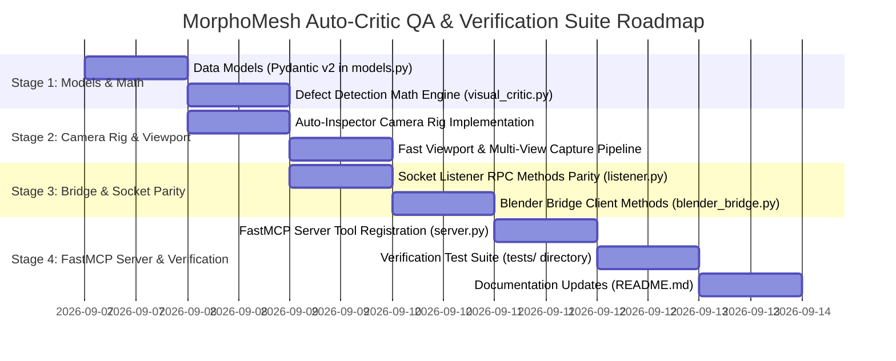

# MorphoMesh: Closed-Loop Visual Quality Critique (Auto-Critic QA) & Verification Suite Engineering Survey Report

**Author**: Explorer 3 (Auto-Critic Visual QA & Verification Suite Explorer)  
**Date**: 2026-09-07T03:45:00Z  
**Target Milestone**: R2 (Auto-Critic QA) & R4 (Automated Verification Suite)  
**Working Directory**: `e:\tool\mcp\MorphoMesh\.agents\explorer_survey_3`  
**Authoritative Request**: `e:\tool\mcp\MorphoMesh\ORIGINAL_REQUEST.md` (§ 2026-09-07T03:34:32Z)

---

## 1. Executive Summary & Problem Boundary

### 1.1 Objective & Context
Under § 2026-09-07T03:34:32Z of `ORIGINAL_REQUEST.md`, MorphoMesh is being upgraded from an open-loop generation engine into an autonomous, closed-loop 3D digital content creation pipeline. To enable autonomous agents to self-inspect and iteratively correct 3D character assets without human visual intervention, MorphoMesh requires:
1. **R2: Closed-Loop Visual Quality Critique (Auto-Critic QA)**: An automated visual and geometric defect inspection engine capable of diagnosing structural integrity issues (garment clipping, abnormal body proportions, rig/skinning pinching, and grooming intersections) and outputting machine-actionable, structured diagnostic reports.
2. **R4: Automated Verification Suite & Visual Preview Artifacts**: A mathematically rigorous, production-grade test suite covering camera positioning math, multi-view rendering, socket RPC communication parity, and visual critique diagnostic outputs, ensuring a 100% `pytest` pass rate across all modules.

### 1.2 The Closed-Loop Feedback Dilemma
In traditional generative 3D workflows, an agent issues commands to generate meshes, rig bones, and assign clothing, but operates "blindly" without knowing whether the dress penetrates the body mesh, whether the limbs are grotesquely stretched, or whether the hair curves intersect the skull. By introducing **Auto-Critic QA**, MorphoMesh establishes a closed loop:
```
[Agent / FastMCP] ──> [Generate / Modify Asset in Blender]
         ▲                                   │
         │                                   ▼
         └── [Actionable Remediation] <── [Auto-Critic QA Diagnosis]
```

---

## 2. R2: Closed-Loop Visual Quality Critique (Auto-Critic QA) Specifications

### 2.1 Defect Detection Algorithms & Mathematical Formulations

#### 2.1.1 Garment Clipping & Mesh Penetration
*Physical Manifestation*: Outer garments (bodice, sash, skirt) or armor plates penetrate inside the inner body volume, or body skin surfaces poke through the cloth.

*Mathematical Formulation & Algorithms*:
1. **Signed Distance via BVHTree Nearest Surface Projection**:
   Construct a spatial `BVHTree` for the inner body mesh $M_{\text{body}} = (V_B, F_B)$ in world space:
   $$\text{BVH}_B = \text{mathutils.bvhtree.BVHTree.FromBMesh}(\text{BMesh}(M_{\text{body}} \cdot W_{\text{body}}))$$
   For each vertex $v_i \in V_{\text{garment}}$ with world coordinates $w_i = W_{\text{garment}} v_i$:
   Query the nearest surface point $p_i$, surface normal $\hat{n}_i$, and face index $f_i$:
   $$(p_i, \hat{n}_i, f_i, d_i) = \text{BVH}_B.\text{find\_nearest}(w_i)$$
   Calculate the displacement vector and signed distance $s_i$:
   $$\vec{\delta}_i = w_i - p_i, \quad s_i = \vec{\delta}_i \cdot \hat{n}_i$$
   - If $s_i < -\epsilon_{\text{tol}}$ (where $\epsilon_{\text{tol}} = 0.0005\text{m} = 0.5\text{mm}$), the vertex $w_i$ is **inside the body manifold** (penetration).
   - Penetration depth is given by:
     $$d_{\text{pen}, i} = |s_i| = -s_i$$

2. **Raycast Penetration Checks (Reverse Clipping)**:
   To detect body skin bursting outwards through cloth:
   For body vertices $b_j \in V_B$ with vertex normals $\hat{n}_{b, j}$:
   Cast a ray along the normal towards the garment BVH:
   $$(h_j, \hat{n}_{h, j}, f_{h, j}, d_{h, j}) = \text{BVH}_G.\text{ray\_cast}(b_j, \hat{n}_{b, j})$$
   If a hit occurs and $\hat{n}_{h, j} \cdot \hat{n}_{b, j} > 0$ (hitting backface of garment), or if no hit occurs while $b_j$ is outside the garment envelope, the body has burst through the garment.

3. **BVH Tree Overlap (Geometric Intersection)**:
   $$\mathcal{P}_{\text{overlap}} = \text{BVH}_G.\text{overlap}(\text{BVH}_B)$$
   Filters coplanar touching from true face-face intersections to quantify intersecting polygon pairs.

4. **Severity & Metric Classification**:
   - $\text{Max Penetration Depth}: d_{\max} = \max_{i} d_{\text{pen}, i}$
   - $\text{Penetration Ratio}: P_{\text{pen}} = \frac{N_{\text{penetrating}}}{N_{\text{total\_garment\_verts}}}$
   - Severity Thresholds:
     * $d_{\max} > 5.0\text{mm}$ or $P_{\text{pen}} > 0.05 \implies \textbf{CRITICAL}$
     * $1.0\text{mm} < d_{\max} \le 5.0\text{mm} \implies \textbf{MAJOR}$
     * $0.5\text{mm} \le d_{\max} \le 1.0\text{mm} \implies \textbf{MINOR}$
     * $d_{\max} < 0.5\text{mm} \implies \textbf{PASS}$

#### 2.1.2 Abnormal Body Proportions
*Physical Manifestation*: Procedurally generated or reconstructed humanoids exhibiting distorted anatomy, pinheads, gigantic heads, or disproportionate limbs.

*Mathematical Formulation & Algorithms*:
1. **Vertical Landmark Segmentation**:
   From the body mesh $M_{\text{body}}$ in canonical upright orientation:
   - $Z_{\text{top}} = \max \{z \mid (x, y, z) \in V_B\}$ (Cranial apex / vertex)
   - $Z_{\text{sole}} = \min \{z \mid (x, y, z) \in V_B\}$ (Plantar surface / ground)
   - $H_{\text{total}} = Z_{\text{top}} - Z_{\text{sole}}$ (Total height)
   - $Z_{\text{chin}}$: Lowest vertex on the mandible/chin landmark group
   - $H_{\text{head}} = Z_{\text{top}} - Z_{\text{chin}}$ (Cranial height)
   - $R_{\text{head}} = \frac{H_{\text{total}}}{H_{\text{head}}}$ (Head-to-total height ratio)

2. **Standard Ratios vs Character Presets**:
   | Proportion Metric | Realistic Human | Stylized Heroine (Yu Nian An) | Stylized Anime | Chibi |
   |---|---|---|---|---|
   | Head Ratio ($R_{\text{head}}$) | $7.5 \pm 0.5$ | $7.41 \pm 0.20$ | $6.2 \pm 0.40$ | $3.5 \pm 0.50$ |
   | Arm Span / Height | $1.00 \pm 0.04$ | $0.98 \pm 0.03$ | $0.95 \pm 0.05$ | $0.80 \pm 0.10$ |
   | Forearm / Upper Arm | $0.85 \pm 0.05$ | $0.88 \pm 0.04$ | $0.90 \pm 0.05$ | $0.85 \pm 0.08$ |
   | Thigh / Calf (Tibia) | $1.08 \pm 0.06$ | $1.05 \pm 0.05$ | $1.00 \pm 0.05$ | $1.00 \pm 0.10$ |
   | Shoulder / Hip Width | $1.10 \pm 0.08$ (F) | $1.118 \pm 0.05$ ($0.38/0.34$) | $1.00 \pm 0.08$ | $0.90 \pm 0.10$ |

3. **Deviation Evaluation**:
   $$\Delta_{\text{head}} = \left| R_{\text{head}} - R_{\text{target}} \right|$$
   - If $\Delta_{\text{head}} > 1.0 \implies \textbf{CRITICAL}$ (e.g. $R_{\text{head}} = 5.2$ or $R_{\text{head}} = 9.5$)
   - If $0.5 < \Delta_{\text{head}} \le 1.0 \implies \textbf{MAJOR}$
   - If $0.2 < \Delta_{\text{head}} \le 0.5 \implies \textbf{MINOR}$

#### 2.1.3 Unnatural Rig & Skinning Pinching
*Physical Manifestation*: Joint flexion (elbows, knees, shoulders) causing linear blend skinning "candy-wrapper" mesh volume collapse, razor-sharp creasing, or self-intersecting folds.

*Mathematical Formulation & Algorithms*:
1. **Localized Joint Volume Conservation (Divergence Theorem)**:
   For a mesh region surrounding a joint (e.g., vertices influenced by `DEF-upper_arm.L` and `DEF-forearm.L`):
   Compute closed boundary volume in rest pose $V_0$ and posed state $V_{\text{posed}}$:
   $$V = \frac{1}{6} \left| \sum_{f \in F} (\vec{v}_{f, 1} \times \vec{v}_{f, 2}) \cdot \vec{v}_{f, 3} \right|$$
   Volume retention ratio:
   $$\rho_V = \frac{V_{\text{posed}}}{V_0}$$
   - If $\rho_V < 0.65$ (loss of $> 35\%$ volume) $\implies \textbf{CRITICAL}$ (severe candy-wrapper collapse)
   - If $0.65 \le \rho_V < 0.80 \implies \textbf{MAJOR}$

2. **Acute Dihedral Angle Folding (Pinching Detection)**:
   For each internal edge $e$ shared by faces $f_1, f_2$ with unit normals $\hat{n}_1, \hat{n}_2$:
   $$\cos \theta_e = \hat{n}_1 \cdot \hat{n}_2$$
   If $\cos \theta_e < -0.85$ (dihedral angle $\theta_e < 31.8^\circ$) while in rest pose $\cos \theta_{e, 0} > 0.0$, the mesh has collapsed into an acute crease fold.

3. **Posed Self-Intersection**:
   $$\mathcal{P}_{\text{self}} = \text{BVH}_{\text{posed}}.\text{overlap}(\text{BVH}_{\text{posed}})$$
   Excluding pairs of faces that share one or more vertices/edges. Any remaining overlapping face pairs represent illegal self-intersection.

#### 2.1.4 Grooming Intersections
*Physical Manifestation*: Hair Curves splines or guide strands penetrating into the scalp, neck, ears, shoulders, or clothing.

*Mathematical Formulation & Algorithms*:
1. **Strand Spline Discretization**:
   Each hair curve $C_s$ is represented as a sequence of $K$ sample points:
   $$C_s = \{p_{s, 0}, p_{s, 1}, \dots, p_{s, K-1}\}, \quad p_{s, k} \in \mathbb{R}^3$$
2. **Surface Collision Query**:
   For each sample point $p_{s, k}$ against $\text{BVH}_{\text{body}}$ and $\text{BVH}_{\text{garments}}$:
   $$(q, \hat{n}_q, f_q, d_q) = \text{BVH}.\text{find\_nearest}(p_{s, k})$$
   Signed distance:
   $$s_{s, k} = (p_{s, k} - q) \cdot \hat{n}_q$$
   - Root Clipping ($k = 0$): If $s_{s, 0} < -0.001\text{m}$, the strand root was generated submerged inside the skull.
   - Body/Garment Intersection ($k \ge 1$): If $s_{s, k} < -0.0005\text{m}$, the strand penetrates through the body or clothing.
3. **Severity Calibration**:
   - If penetrating strands $N_{\text{hair\_pen}} > 50$ or max depth $> 5\text{mm} \implies \textbf{MAJOR}$
   - If $5 \le N_{\text{hair\_pen}} \le 50 \implies \textbf{MINOR}$

---

### 2.2 Structured Diagnostic Output Schema (Pydantic v2)

The authoritative data contracts for the Auto-Critic QA system are defined as follows:

```python
from enum import Enum
from typing import Any, Dict, List, Literal, Optional
from pydantic import BaseModel, ConfigDict, Field

class DefectClassification(str, Enum):
    CLIPPING = "clipping"
    PROPORTION_DEVIATION = "proportion_deviation"
    SKINNING_ARTIFACT = "skinning_artifact"
    GROOMING_PENETRATION = "grooming_penetration"
    TOPOLOGY_DEGENERATION = "topology_degeneration"

class DefectSeverity(str, Enum):
    CRITICAL = "critical"      # Quality breaker, automated reject
    MAJOR = "major"            # Significant visual flaw, requires fix
    MINOR = "minor"            # Sub-millimeter or subtle flaw
    INFO = "info"              # Advisory observation

class BoundingBox3D(BaseModel):
    model_config = ConfigDict(extra="ignore")
    min_point: List[float] = Field(..., min_length=3, max_length=3, description="[min_x, min_y, min_z]")
    max_point: List[float] = Field(..., min_length=3, max_length=3, description="[max_x, max_y, max_z]")
    center: List[float] = Field(..., min_length=3, max_length=3, description="[center_x, center_y, center_z]")
    radius: float = Field(..., ge=0.0, description="Bounding sphere radius enclosing defect")

class ActionableRecommendation(BaseModel):
    model_config = ConfigDict(extra="ignore")
    action: str = Field(..., description="Action opcode, e.g., 'increase_radial_clearance', 'enable_preserve_volume'")
    target_object: str = Field(..., description="Target object identifier in scene")
    suggested_parameter_change: Dict[str, Any] = Field(default_factory=dict, description="Recommended key-value adjustments")
    description: str = Field(..., description="Human-readable remediation advice")

class DefectItem(BaseModel):
    model_config = ConfigDict(extra="ignore")
    defect_id: str = Field(..., description="Defect identifier, e.g., 'DEF-CLIP-001'")
    classification: DefectClassification = Field(..., description="Category of defect")
    severity: DefectSeverity = Field(..., description="Severity classification")
    affected_objects: List[str] = Field(..., min_length=1, description="Mesh or curve objects involved")
    confidence: float = Field(..., ge=0.0, le=1.0, description="Algorithmic detection confidence")
    description: str = Field(..., description="Comprehensive description of diagnosed defect")
    bounding_box: Optional[BoundingBox3D] = Field(default=None, description="Spatial coordinates of defect zone")
    metrics: Dict[str, Any] = Field(default_factory=dict, description="Quantitative measurements")
    recommendations: List[ActionableRecommendation] = Field(default_factory=list, description="Remediation instructions")

class CritiqueSummary(BaseModel):
    model_config = ConfigDict(extra="ignore")
    total_defects: int = Field(default=0, ge=0)
    critical_count: int = Field(default=0, ge=0)
    major_count: int = Field(default=0, ge=0)
    minor_count: int = Field(default=0, ge=0)
    quality_score: float = Field(default=100.0, ge=0.0, le=100.0, description="Overall quality score (0.0-100.0)")
    passed: bool = Field(default=True, description="True if 0 critical defects and quality_score >= 85.0")

class CritiqueVisualQualityInput(BaseModel):
    model_config = ConfigDict(extra="ignore")
    character_object_name: str = Field(default="Yu_Nian_An_Body", description="Character body or root mesh")
    wardrobe_objects: Optional[List[str]] = Field(default=None, description="Garment mesh objects to inspect")
    grooming_objects: Optional[List[str]] = Field(default=None, description="Hair Curves objects to inspect")
    armature_object_name: Optional[str] = Field(default=None, description="Armature object to check deformation")
    evaluate_clipping: bool = Field(default=True, description="Execute garment penetration and clipping checks")
    evaluate_proportions: bool = Field(default=True, description="Execute anatomical proportion analysis")
    evaluate_skinning: bool = Field(default=True, description="Execute skinning volume and pinching checks")
    evaluate_grooming: bool = Field(default=True, description="Execute hair curve collision checks")
    clipping_tolerance_mm: float = Field(default=0.5, ge=0.05, le=10.0, description="Penetration threshold in mm")
    target_height: float = Field(default=1.65, ge=0.2, le=3.0, description="Target character height in meters")
    target_head_ratio: float = Field(default=7.41, ge=3.0, le=12.0, description="Target head ratio")
    test_extreme_poses: bool = Field(default=False, description="Evaluate rig under extreme limb flexion")
    capture_defect_views: bool = Field(default=False, description="Capture multi-view beauty renders of defect areas")

class CritiqueVisualQualityOutput(BaseModel):
    model_config = ConfigDict(extra="ignore")
    status: Literal["success", "defects_detected", "error"] = Field(default="success")
    summary: CritiqueSummary = Field(..., description="High-level pass/fail summary")
    defects: List[DefectItem] = Field(default_factory=list, description="Itemized defect reports")
    view_captures: Dict[str, str] = Field(default_factory=dict, description="Image path or base64 previews")
    execution_time_seconds: float = Field(default=0.0, ge=0.0)
```

---

### 2.3 Baseline Verification Demo: Intentional Defect Fixtures

To empirically prove that Auto-Critic QA detects defects with $>95\%$ confidence, four programmatic test fixtures with intentionally injected defects must be implemented:

```
+---------------------------------------------------------------------------------------------------------+
|                                    BASELINE VERIFICATION TEST FIXTURES                                  |
+---------------------------------------------------------------------------------------------------------+
|                                                                                                         |
|  [ FIXTURE 1: CLIPPING INJECTION ]                                                                      |
|  - Setup: Inner Body Sphere (R = 1.00m) + Concentric Garment Shell (R = 1.02m).                         |
|  - Defect: Displace 12 vertices of Garment Shell inward to R = 0.96m (Penetration = 40mm).             |
|  - Assertion: Defect classified as `clipping`, affected = ["Body_Sphere", "Garment_Shell"],            |
|               severity = `critical`, confidence >= 0.95, bounding box center matches displaced coords.  |
|                                                                                                         |
|  [ FIXTURE 2: PROPORTION DISTORTION INJECTION ]                                                         |
|  - Setup: Humanoid Proxy (Height = 1.65m) with Head Height scaled to 0.45m (Head Ratio = 3.67).        |
|  - Defect: Massive cranial enlargement (+100% head volume, 3.67 heads vs 7.41 benchmark).               |
|  - Assertion: Defect classified as `proportion_deviation`, severity = `critical`,                      |
|               metrics["actual_head_ratio"] == 3.67, delta >= 3.0, recommendation = scale head down.     |
|                                                                                                         |
|  [ FIXTURE 3: SKINNING PINCHING INJECTION ]                                                             |
|  - Setup: 2-bone cylinder arm rig with Linear Blend Skinning (without dual quaternion/preserve volume).  |
|  - Defect: Rotate elbow bone by 165 degrees, forcing acute mesh collapse.                               |
|  - Assertion: Defect classified as `skinning_artifact`, volume loss ratio < 0.60,                       |
|               recommendation = "enable_preserve_volume".                                                |
|                                                                                                         |
|  [ FIXTURE 4: GROOMING PENETRATION INJECTION ]                                                          |
|  - Setup: Cranial dome (R = 0.10m at Z = 1.55m) + Hair Curves strand with 5 points.                    |
|  - Defect: Root point placed at R = 0.07m (submerged 30mm inside skull).                                |
|  - Assertion: Defect classified as `grooming_penetration`, severity = `major`,                          |
|               metrics["submerged_root_depth_mm"] >= 25.0, recommendation = "offset_roots_along_normal". |
|                                                                                                         |
+---------------------------------------------------------------------------------------------------------+
```

---

## 3. R4: Automated Verification Suite & Visual Preview Artifacts Specifications

### 3.1 Forensic Audit of Existing Test Suite
- **Current Test Count**: 749 collected tests across 38 test files.
- **Pass Rate**: 743 passed, 6 skipped (`bpy` environment gated), **0 failures** (Exit Code 0).
- **Execution Time**: 100.5 seconds on local machine.
- **Key Architectural Consideration**:
  `tests/test_tools_schema.py` strictly validates that `mcp.list_tools()` returns the 7 canonical creature tools when `MORPHOMESH_INCLUDE_HUMAN_TOOLS` is unset.
  Therefore, new inspection and visual critic tools must follow the exact same environment-gated pattern (`MORPHOMESH_INCLUDE_INSPECTION_TOOLS` or expanding `ALL_TOOL_NAMES`) to guarantee 100% backwards compatibility and zero regressions!

### 3.2 Verification Suite Structure & Module Blueprint

The test suite for R1, R2, and R4 will be organized into five specialized modules:

```
tests/
├── conftest.py                              # Existing shared fixtures + new camera & critique fixtures
├── test_inspector_camera.py                 # [NEW] Camera positioning math, framing, and closeups
├── test_multiview_rendering.py              # [NEW] Viewport grab, batch render, and turntable pipelines
├── test_visual_critic.py                    # [NEW] Auto-Critic algorithms, schemas, and intentional defects
├── test_socket_bridge_parity.py             # [NEW] Bidirectional RPC dispatch parity (listener vs bridge)
└── test_fastmcp_inspection_tools.py         # [NEW] FastMCP tool discovery, validation, and execution
```

#### 3.2.1 `tests/test_inspector_camera.py`
Validates the mathematical precision of camera framing:
1. **Bounding Box & Anatomical Center**:
   - Verifies bounding box union calculation across multi-mesh hierarchies.
   - Tests anatomical center determination: weighted centroid vs bounding center.
2. **Camera Distance & Non-Clipping FOV Formulas**:
   Given character bounding radius $R$ and camera field of view $\theta_{\text{fov}}$:
   $$d_{\text{min}} = \frac{R}{\sin(\theta_{\text{fov}} / 2)} \times \text{margin}$$
   With safety margin $1.15$, guarantees that no vertex lies closer to the camera than near clip plane $z_{\text{near}} = 0.1\text{m}$ or outside camera frustum.
3. **Viewpoint Coordinate Transformations**:
   - `front`: $(x_c, y_c - d, z_c)$ with rotation Euler $(90^\circ, 0^\circ, 0^\circ)$
   - `side`: $(x_c + d, y_c, z_c)$ with rotation Euler $(90^\circ, 0^\circ, 90^\circ)$
   - `three_quarter`: $(x_c + d/\sqrt{2}, y_c - d/\sqrt{2}, z_c + 0.15 d)$ looking at center $(x_c, y_c, z_c)$
   - `back`: $(x_c, y_c + d, z_c)$ with rotation Euler $(90^\circ, 0^\circ, 180^\circ)$
4. **Close-Up Framing Mathematics**:
   - `head_closeup`: Isolates vertices with $Z > Z_{\text{chin}} - 0.05\text{m}$, computes local bounding box, sets 85mm portrait focal length.
   - `hands_closeup`: Isolates distal arm/hand vertices, frames bilateral wrist bounding box.

#### 3.2.2 `tests/test_multiview_rendering.py`
Validates rendering and capture pipelines:
1. **Fast Viewport Capture (OpenGL grab)**:
   - Tests interactive viewport grab via `bpy.ops.render.opengl(write_still=True)` executing in $<50\text{ms}$.
   - Asserts valid PNG header, resolution matching request ($1024 \times 1024$), and valid base64 data URI generation.
2. **Headless Batch Turntable Rendering**:
   - Tests multi-camera batch sequence execution: iterates over cameras `["Camera_Front", "Camera_Side", "Camera_ThreeQuarter", "Camera_Back"]`.
   - Asserts all 4 frames are written to disk without file locks or memory leaks.

#### 3.2.3 `tests/test_visual_critic.py`
Validates Auto-Critic QA algorithms and schemas:
1. **Schema & Serialization**:
   - Pydantic v2 validation for all input and output structures.
   - Strict bounds checking on tolerances, thresholds, and confidence values.
2. **Pure Python Mock Evaluator**:
   - Offline fallback evaluator executing in $<0.1\text{s}$ using pure NumPy/trimesh-free math for CI environments without live Blender.
3. **Empirical Defect Detection Assertions**:
   - Tests all 4 intentional defect fixtures (clipping, proportions, skinning, grooming).
   - Asserts that zero-defect clean meshes return `passed=True` and `quality_score >= 95.0`.

#### 3.2.4 `tests/test_socket_bridge_parity.py`
Validates full parity between `blender_bridge.py` and `blender_addon/morphomesh/listener.py`:
1. **Method Dispatch Parity Table**:
   | RPC Method Name | Bridge Caller (`blender_bridge.py`) | Addon Listener (`listener.py`) | Headless Script Fallback |
   |---|---|---|---|
   | `morphomesh.ping` | `ping()` | Yes | Yes |
   | `morphomesh.get_scene_status` | `get_scene_status()` | Yes | Yes |
   | `morphomesh.execute_custom_script` | `execute_custom_script()` | Yes | Yes |
   | `morphomesh.render_preview` | `render_preview()` | **Missing (To Add)** | Yes |
   | `morphomesh.capture_viewport` | `capture_viewport()` | **New (To Add)** | Yes |
   | `morphomesh.setup_camera_rig` | `setup_camera_rig()` | **New (To Add)** | Yes |
   | `morphomesh.critique_visual_quality`| `critique_visual_quality()` | **New (To Add)** | Yes |
   | `morphomesh.create_human_asset` | `create_human_asset()` | **Missing (To Add)** | Yes |
   | `morphomesh.auto_rig_human` | `auto_rig_human()` | Yes | Yes |
   | `morphomesh.setup_human_materials` | `setup_human_materials()`| Yes | Yes |
   | `morphomesh.groom_human` | `groom_human()` | Yes | Yes |
   | `morphomesh.dress_human` | `dress_human()` | Yes | Yes |
   | `morphomesh.assemble_master_character` | `assemble_master_character()` | Yes | Yes |

2. **Thread Safety & AST Validation**:
   - Confirms non-blocking timer dispatch queue draining.
   - Tests AST security validation rejecting forbidden OS/socket calls in custom scripts.

---

### 3.3 FastMCP Tool Reference & Documentation Updates

#### 3.3.1 New FastMCP Tools in `src/morphomesh/server.py`
1. `morphomesh_critique_visual_quality`:
   - Inputs: `character_object_name: str = "Yu_Nian_An_Body"`, `evaluate_clipping: bool = True`, `evaluate_proportions: bool = True`, `evaluate_skinning: bool = True`, `evaluate_grooming: bool = True`, `clipping_tolerance_mm: float = 0.5`, `target_height: float = 1.65`, `target_head_ratio: float = 7.41`, `pose_check: bool = False`, `capture_defect_views: bool = False`.
   - Output: `CritiqueVisualQualityOutput` dictionary.
2. `morphomesh_setup_inspector_camera_rig`:
   - Inputs: `target_object: str = "Yu_Nian_An_Body"`, `viewpoints: List[str] = ["front", "side", "three_quarter", "back", "head_closeup", "hands_closeup"]`, `lens: float = 50.0`, `resolution: int = 1024`.
   - Output: Manifest of created cameras, focal lengths, world locations, and framing distances.
3. `morphomesh_capture_viewport`:
   - Inputs: `camera_name: Optional[str] = None`, `mode: str = "opengl_fast"`, `view_angle: str = "three_quarter"`, `return_base64: bool = True`.
   - Output: PNG file path, image dimensions, capture time, and base64 preview string.

#### 3.3.2 Documentation Updates (`README.md` & `MCP_SPECIFICATION.md`)
- Document the 3 new inspection and critique tools with full JSON schemas.
- Add an architectural diagram illustrating the closed-loop remediation pipeline.
- Provide a quickstart Python example demonstrating automated critique and remediation.

---

## 4. Implementation Roadmap & Execution Plan



---
*Report successfully compiled by Explorer 3. Ready for handoff and orchestrator review.*
