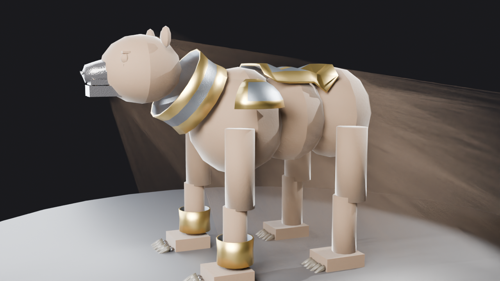
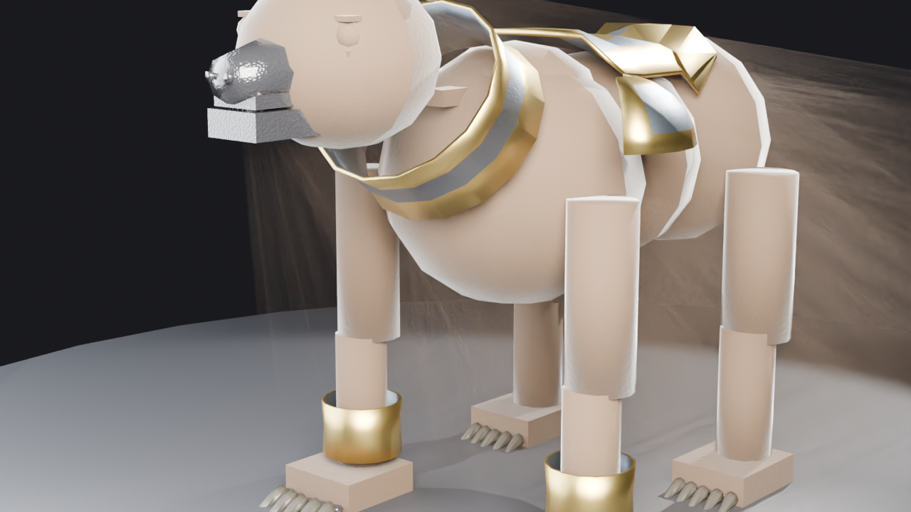
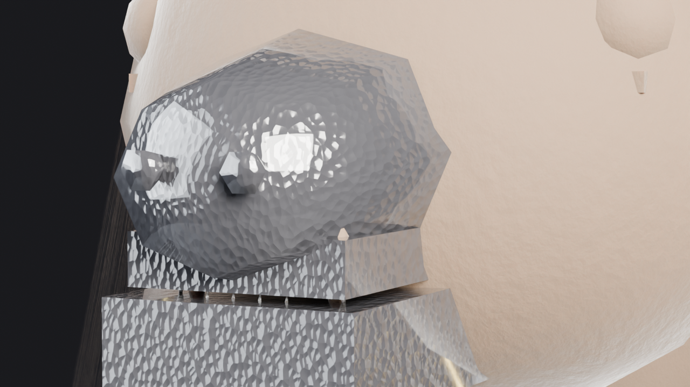
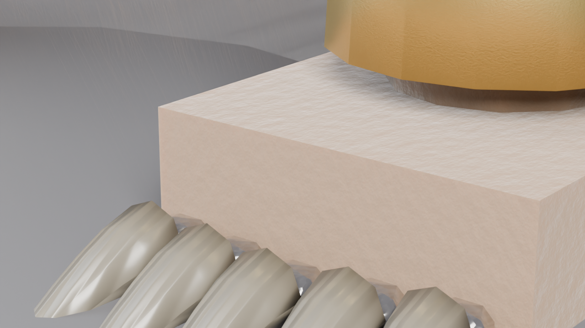
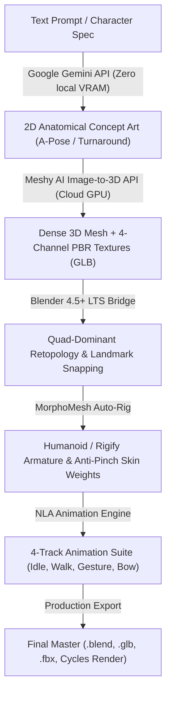

# MorphoMesh: AI 3D Creature Generation Pipeline & FastMCP Blender Bridge

[](pyproject.toml)
[](https://github.com/DuongNAD/MorphoMesh)
[](docs/MCP_SPECIFICATION.md)
[](https://www.blender.org)
[](docs/ARCHITECTURE.md)
[](LICENSE)

**MorphoMesh** is an open-source, automated AI 3D creature generation pipeline and Model Context Protocol (MCP) server connecting **Google Antigravity 2.0** and autonomous AI agents directly with **Blender 5.2.1 LTS**.

Unlike conventional humanoid-centric generative 3D tools, MorphoMesh is purpose-built to solve the acute geometric, topological, biomechanical, and grooming challenges of non-humanoid lifeforms: quadrupeds (canines, felines, equines, ursids), avians (raptors, birds), and multi-limbed, winged fantasy chimeras (dragons, griffins). It synthesizes complete, game- and film-ready assets—from anatomical base meshes and quad retopology to hair-strand fur grooming, procedural PBR shaders, articulated armor, and metarig armatures.

---

## Visual Showcase: Production Armored War Bear (Ursus Ferox)

Below are multi-angle renders generated entirely via MorphoMesh's automated procedural anatomy, grooming, shader networks, and armor fitting engines in Blender 5.2.1 LTS:

| Full Body Stance | Front 3/4 Perspective |
| :---: | :---: |
|  |  |
| **Cranial & Gorget Detail** | **Paw & Articulated Claws Detail** |
|  |  |

---

## Table of Contents
1. [Core Features & Systems](#core-features--systems)
2. [Hybrid Computing Topology](#hybrid-computing-topology)
3. [The 5-Stage Synthesis Pipeline](#the-5-stage-synthesis-pipeline)
4. [Open-Source Integration Hub](#open-source-integration-hub)
5. [Anatomy, Grooming, Materials & Armor](#anatomy-grooming-materials--armor)
6. [Installation & Quickstart](#installation--quickstart)
7. [FastMCP Tool Reference (Core & Inspection Tools)](#fastmcp-tool-reference-core--inspection-tools)
8. [Multi-Angle Inspection Camera & Viewport Capture](#multi-angle-inspection-camera--viewport-capture)
9. [Closed-Loop Visual Quality Critique (Auto-Critic QA)](#closed-loop-visual-quality-critique-auto-critic-qa)
10. [Dual-Mode Blender Bridge Architecture](#dual-mode-blender-bridge-architecture)
11. [AST Security Sandbox](#ast-security-sandbox)
12. [Google Antigravity 2.0 Configuration](#google-antigravity-20-configuration)
13. [CLI Usage Guide](#cli-usage-guide)
14. [Verification & Conformance Testing](#verification--conformance-testing)
15. [Documentation Index](#documentation-index)
16. [License & Acknowledgments](#license--acknowledgments)

---

## Core Features & Systems

- **Zero-VRAM Offline Procedural Engine**: Generates mathematically sound 3D meshes (quadrupeds, bipeds, winged chimeras, primitives) in both binary `.glb` (glTF 2.0) and ASCII `.obj` containers with genuine PBR PNG texture maps (Albedo, Normal, Roughness, Metallic) using PIL and NumPy—requiring 0 MB GPU VRAM.
- **Open-Source 3D Connector Hub**: Unifies top-tier generative and topological models (TRELLIS, 3DAnimals / SMAL, anyCreature, MeshAnything, Hunyuan3D) under a resilient DAG with automatic fallback.
- **Biomechanical Creature Anatomy Generator**: Synthesizes skeletal-accurate bone and muscle masses, cranial/snout/jaw structures, and dedicated plantigrade/digitigrade paw topologies with articulated claw beds.
- **Dual-Coat Fur & Grooming Engine**: Implements Blender Hair Curves with procedural geometry nodes for dense undercoats, coarse guard hairs, guide interpolation, and direction-aware combing vector fields.
- **Multi-Layer Creature PBR Materials**: Subsurface Scattering (SSS) skin/flesh shaders, anisotropic sheen fur BSDFs, micro-scratched keratin horn/claw shaders, and wet-specular rhinarium/eye networks.
- **Articulated War Armor Assembly**: Generates fitted segmented armor plates (cranium chanfron, neck gorget, shoulder pauldrons, rib cuirass, greaves) with leather strapping and battle-worn hammered steel.
- **Blender 5.2.1 LTS Metal Hardware Acceleration**: Native Apple Silicon Metal GPU raytracing support with automatic engine identifier normalization (`BLENDER_EEVEE_NEXT` -> `BLENDER_EEVEE`).
- **Two-Tier AST Security Sandbox**: Proactively inspects all agent-submitted Python scripts via Abstract Syntax Tree traversal (`BpyCodeValidator`), blocking unauthorized system calls, network sockets, reflection, and file I/O.

---

## Hybrid Computing Topology

```
+---------------------------------------------------------------------------------------------------------+
|                                    MORPHOMESH THREE-TIER HYBRID TOPOLOGY                                |
+---------------------------------------------------------------------------------------------------------+
|                                                                                                         |
|  [ LAYER 1: CLIENT & COORDINATION LAYER ]                                                               |
|  - Host: macOS Apple Silicon Workstation (Darwin ARM64) / Linux x86_64                                   |
|  - Agent Host: Google Antigravity 2.0 (Autonomous Orchestrator)                                         |
|  - Gateway: MorphoMesh FastMCP Server (Python 3.11+ / mcp 1.28.1) via stdio / SSE transport             |
|  - Validation: Pydantic v2 schemas and strict parameter unpacking discipline                            |
|                                                                                                         |
|  [ LAYER 2: BLENDER COMMUNICATION LAYER ]                                                               |
|  - Dual-Mode Bridge: Localhost TCP Socket (127.0.0.1:9876) + Headless CLI Fallback (blender -b -P)        |
|  - Synchronization: Non-blocking bpy.app.timers event loop queue consumer (<2ms dispatch latency)       |
|  - Environment: Blender 5.2.1 LTS with Apple Metal GPU backend & EEVEE render engine                   |
|  - Security: Two-tier Abstract Syntax Tree (AST) static analysis (BpyCodeValidator)                     |
|                                                                                                         |
|  [ LAYER 3: INFERENCE & CONNECTOR LAYER ]                                                               |
|  - Local Offline Engine: Deterministic Procedural Mock Generator (0 VRAM, 100% offline, 0 API cost)     |
|  - Open-Source Hub: TRELLIS, 3DAnimals / SMAL, anyCreature, MeshAnything, Hunyuan3D                     |
|  - Local Apple Silicon Fallback: Native Blender QuadriFlow remesher & Rigify creature metarigs          |
|  - Remote GPU Tier: Dedicated Linux GPU / Serverless Cloud (Replicate, Hugging Face, RunPod)           |
|                                                                                                         |
+---------------------------------------------------------------------------------------------------------+
```

---

## The 5-Stage Synthesis Pipeline


1. **Stage 1: Concept & Conditioning (`morphomesh_generate_concept`)**
   Expands unstructured prompts with biological archetype priors (neutral stance, planar limb alignment, studio illumination, alpha-isolated solid backdrop).
2. **Stage 2: Single-Image to 3D Generation (`morphomesh_create_3d_asset`)**
   Feeds creature silhouettes into 3D diffusion backends (TRELLIS, Hunyuan3D, or local offline procedural engine), producing watertight 3D meshes with full PBR texture channels.
3. **Stage 3: Topology Optimization (`morphomesh_optimize_topology`)**
   Transforms dense raw geometry into clean, quad-dominant meshes conforming to user polycount budgets via MeshAnything or Blender QuadriFlow.
4. **Stage 4: Skeleton & Rigging Automation (`morphomesh_auto_rig`)**
   Locates anatomical landmarks (cranium, pelvis, spine joints, limb chains, claws, tail), builds modular Rigify armatures, and computes heat-mapped skinning weights.
5. **Stage 5: Scene Assembly, Shading & Rendering (`morphomesh_render_preview`)**
   Applies procedural fur grooming, equips armor plating, builds PBR node trees, frames the subject with auto-calculated 3D bounding spheres, and renders preview images via Apple Metal EEVEE.

---

## Open-Source Integration Hub

MorphoMesh provides dedicated, production-tested connectors in [`src/morphomesh/connectors`](src/morphomesh/connectors/):

| Connector | Model Name | Role | Primary Strengths |
|---|---|---|---|
| `MeshyConnector` | **Meshy AI (v4 / boost)** | Cloud Image/Text-to-3D Synthesis | Ultra low-latency cloud generation with smart quad topology and full PBR material baking |
| `GeminiImageConnector` | **Google Gemini / Imagen** | 2D Concept Art Synthesis | Photorealistic 2D character/creature concept turnaround generation conditioned on anatomical priors |
| `TrellisConnector` | **TRELLIS** | 3D Asset Synthesis | High-fidelity Gaussian & mesh generation with full PBR maps |
| `TripoConnector` | **Tripo3D (v3.1 / P1)** | Text/Image-to-3D Synthesis | High-fidelity text-to-3D, image-to-3D, and draft-to-refine with PBR |
| `Animals3DConnector` | **3DAnimals / SMAL** | Morphological Priors | Parametric quadruped shapes (canines, equines, felines, ursids) |
| `AnyCreatureConnector` | **anyCreature** | Kinematics & Rigging | Handles multi-limbed fantasy chimeras, dragons, and wing joints |
| `MeshAnythingConnector` | **MeshAnything** | Artist-Grade Retopology | Generates quad-dominant production topology from raw meshes |
| `HunyuanConnector` | **Hunyuan3D-2.1** | Multiview 3D Diffusion | High geometric detail and crisp structural boundaries |

### Resource-Optimized Hybrid Workflow (Zero-VRAM Pipeline)
To maximize throughput and eliminate the requirement for massive local GPU VRAM (16GB–24GB required by local diffusion models), MorphoMesh supports an optimized **API-Driven Hybrid Pipeline**:



**Key Advantages**:
- **0 GB Local Neural VRAM**: Heavy image diffusion and 3D reconstruction occur via Gemini and Meshy AI cloud APIs.
- **Fast Production Cycle**: Complete character creation, rigging, and animation generation in under 3 minutes.
- **Comprehensive Deliverables**: Produces production-ready `.blend` scenes, real-time WebGL/game `.glb` (with embedded animation clips and morph targets), and game-engine `.fbx`.

### Resilient Fallback DAG
When cloud endpoints or GPUs are unavailable, the execution orchestrator falls back automatically to local procedural generation, ensuring offline independence and uninterrupted agent workflows.

---

## Anatomy, Grooming, Materials & Armor

MorphoMesh provides specialized modules for high-end creature craftsmanship:

### 1. Creature Anatomy Generator ([`src/morphomesh/creature_generator.py`](src/morphomesh/creature_generator.py))
- Generates anatomical volume distributions across torso, neck, head, snouts, jawlines, and limbs.
- Distinguishes between **digitigrade** (canine/feline) and **plantigrade** (ursid/humanoid) foot anatomy.
- Spawns articulated claw beds with independent curved claw meshes.

### 2. Fur Grooming System ([`src/morphomesh/grooming.py`](src/morphomesh/grooming.py))
- Uses modern Blender Hair Curves with Geometry Node modifier stacks.
- Generates dual coats: short, high-density **undercoat** (thermal volume) and long, oriented **guard hairs** (profile silhouette).
- Implements procedural vector-field combing, guide interpolation, and clump/kink curl modifiers.

### 3. Procedural Creature Materials ([`src/morphomesh/materials.py`](src/morphomesh/materials.py))
- **Creature Skin**: Dual-depth Subsurface Scattering (SSS) simulating subdermal blood perfusion and epidermis diffuse.
- **Fur BSDF**: Directional anisotropic sheen, melanin color variation, and root-to-tip gradient darkening.
- **Keratin Claws/Horns**: High-roughness fibrous sheen with procedural micro-scratches and bump mapping.
- **Rhinarium & Eyes**: Wet specular gloss with high clearcoat and custom normal perturbation.

### 4. Modular Armor & Equipment ([`src/morphomesh/armor.py`](src/morphomesh/armor.py))
- Procedural anatomical plate wrapping conforming to creature bounding volumes.
- Modular components: **Chanfron** (head plate), **Gorget** (segmented neck collar), **Pauldrons** (shoulder guards), **Cuirass** (segmented rib cage plates), and **Greaves** (foreleg guards).
- PBR battle-worn hammered steel and embossed leather strap fasteners.

---

## Installation & Quickstart

### Prerequisites
- **Python**: 3.10+ (Recommended 3.11+)
- **Package Manager**: [`uv`](https://github.com/astral-sh/uv) (strongly recommended) or `pip`
- **Blender**: Blender 4.2 LTS, 4.3+, or 5.2.1 LTS (accessible via `PATH` or `BLENDER_EXECUTABLE`)
- **OS**: macOS Apple Silicon (Metal acceleration), Linux x86_64 (CUDA 12.x), or Windows 10/11

### Quickstart with `uv`
```bash
# 1. Clone repository
git clone https://github.com/DuongNAD/MorphoMesh.git
cd MorphoMesh

# 2. Create isolated virtual environment & install in editable mode
uv venv .venv --python 3.11
# macOS / Linux:
source .venv/bin/activate
# Windows (PowerShell):
.venv\Scripts\Activate.ps1

uv pip install -e ".[dev]"

# 3. Verify installation and tool discovery
uv run morphomesh --version
# Output: MorphoMesh v0.1.0

# 4. Launch FastMCP server
uv run morphomesh server --transport stdio

# 5. Execute automated test suite
uv run pytest tests/ -m "not live_blender"
```

---

## Project Architecture & Directory Layout

MorphoMesh is engineered into 11 cohesive sub-packages under `src/morphomesh/`, with backward-compatible facade re-exports at the package root:

```text
MorphoMesh/
├── src/morphomesh/
│   ├── models/                 # Domain Pydantic v2 schemas, errors, and enums
│   │   ├── creature.py         # Creature generation, rigging, topology models
│   │   ├── human.py            # Digital human base mold & wardrobe models
│   │   ├── inspection.py       # Camera rig & viewport capture models
│   │   ├── critique.py         # Closed-loop defect classification models
│   │   ├── animation.py        # Skeletal motion & retargeting models
│   │   ├── enums.py            # Taxonomy enums (CreatureType, Pose, ViewMode)
│   │   └── errors.py           # Standardized error codes (32 constants)
│   ├── geometry/               # Core in-memory geometry & format exporters
│   │   ├── mesh.py             # MeshGeometry class (vertices, faces, UVs, normals)
│   │   ├── exporters.py        # Pure-Python binary glTF 2.0 (.glb) & OBJ exporters
│   │   ├── primitives.py       # Procedural geometric cylinders, cubes, spheres
│   │   └── quad_utils.py       # Quad topology checks and polygon triangulation
│   ├── inference/              # Generative backends & external connectors
│   │   ├── base.py             # BaseInferenceAdapter & CircuitBreaker contracts
│   │   ├── mock.py             # Zero-VRAM deterministic procedural generator
│   │   ├── replicate.py        # Replicate FLUX & 3D endpoint client
│   │   ├── huggingface.py      # Hugging Face Inference Endpoints client
│   │   └── factory.py          # Pluggable adapter instantiation factory
│   ├── bridge/                 # Blender communication & security sandboxing
│   │   ├── client.py           # Localhost TCP client with NDJSON streaming
│   │   ├── headless.py         # Headless CLI subprocess runner with sentinels
│   │   ├── validator.py        # AST BpyCodeValidator static security analyzer
│   │   ├── constants.py        # Protocol port 9876, timeouts, RPC command enums
│   │   └── scripts/            # Modular domain Python scripts for Blender
│   ├── tools/                  # 19 FastMCP tool declarations & environment gating
│   │   ├── creature.py         # 7 creature generation & scene tools
│   │   ├── human.py            # 7 digital human generation & assembly tools
│   │   ├── inspection.py       # 3 inspection camera & visual critic tools
│   │   ├── animation.py        # 2 skeletal animation dispatch tools
│   │   ├── gating.py           # Dual-layer environment gating matrix
│   │   ├── registry.py         # Central tool registration orchestrator
│   │   └── server_instance.py  # FastMCP server factory & singleton
│   ├── human/                  # Anatomical human body generation & molds
│   │   ├── mold_loader.py      # MakeHuman CC0 female base mold loader
│   │   ├── morphology.py       # Morphological adjustments (teardrop bust, hips)
│   │   └── anatomy.py          # Anthropometric landmarks & 24 vertex groups
│   ├── rigging/                # Armatures, skin weights & blendshapes
│   │   ├── metarig.py          # 163 DEF bone Rigify Human Metarig generator
│   │   ├── anti_pinch.py       # Volume-preserving anti-pinch joint weights
│   │   └── blendshapes.py      # 52 ARKit FACS morph targets delta calculation
│   ├── wardrobe/               # Dynamic clothing, footwear & props
│   │   ├── garments.py         # Sundress bodice, sash, skirt, strappy sandals
│   │   ├── props.py            # Marionette red threads & glowing butterflies
│   │   └── skinning.py         # Geodesic pin weights & cloth collision setup
│   ├── grooming/               # Volumetric hair curves & fur systems
│   │   ├── hime_cut.py         # Straight bangs and sidelock spline generation
│   │   ├── curves_pipeline.py  # Geometry Nodes hair curves modifier tree
│   │   └── creature.py         # Multi-layer quadruped fur grooming
│   ├── assembler/              # Master character assembly & packaging
│   │   ├── assembler.py        # Yu Nian An master scene integrator
│   │   ├── pbr_baker.py        # 4K procedural PBR texture baker (Random Walk SSS)
│   │   ├── scene_builder.py    # 3-point studio lighting & camera presets
│   │   └── packager.py         # Production packaging (.blend, .glb, .fbx)
│   ├── critic/                 # Closed-loop automated visual quality critique
│   │   ├── bvh.py              # PurePythonBVHTree spatial bounding hierarchy
│   │   ├── geometry_math.py    # Möller–Trumbore ray-triangle & distance math
│   │   ├── penetration.py      # Cloth-body penetration & hair collision checks
│   │   ├── proportions.py      # Anthropometric proportions evaluation
│   │   ├── deformation.py      # Joint pinch volume loss & acute crease detection
│   │   └── reporter.py         # Defect classification & benchmark harness
│   ├── anatomy/                # Biomechanical locomotion & skeleton estimation
│   │   ├── locomotor.py        # Stance classification (Humanoid, Plantigrade, etc.)
│   │   ├── landmarks.py        # Bony landmark identification & joint centers
│   │   ├── bone_roll.py        # Hinge normal vector & biomechanical roll solver
│   │   └── biharmonic.py       # Geodesic voxel skin weight diffusion solver
│   └── connectors/             # Open-source connectors (TRELLIS, SMAL, anyCreature)
├── blender_addon/              # Blender 4.x / 5.x companion addon & TCP socket listener
├── docs/                       # Authoritative specifications and documentation
│   ├── DEVELOPER_GUIDE.md      # Setup, architecture map, 5 extension recipes, testing
│   ├── MCP_SPECIFICATION.md    # Complete 19-tool FastMCP specification & schemas
│   ├── ARCHITECTURE.md         # System architecture, Mermaid diagrams, protocol specs
│   ├── RESEARCH_BENCHMARK.md   # 20+ SOTA model comparisons & benchmark matrix
│   ├── OPEN_SOURCE_INTEGRATION_PLAYBOOK.md # SOTA open-source engineering playbook
│   └── ROADMAP.md              # Multi-phase project development roadmap
└── tests/                      # 98 comprehensive test suites & adversarial benchmarks
```

---

## FastMCP 19-Tool Reference & Environment Gating

MorphoMesh exposes **19 atomic FastMCP tools** across 4 specialized domains. All tools strictly validate inputs via Pydantic v2 schemas.

### The 19-Tool Master Matrix

| # | Tool Name | Category | Description | Gating Requirement |
|---|---|---|---|---|
| 1 | `morphomesh_generate_concept` | Creature (1/7) | Generates standardized 2D concept images with anatomical view conditioning | Active by default |
| 2 | `morphomesh_create_3d_asset` | Creature (2/7) | Reconstructs 3D mesh with PBR textures from 2D concept image | Active by default |
| 3 | `morphomesh_optimize_topology` | Creature (3/7) | Retopologizes dense meshes to animation-ready quad topology | Active by default |
| 4 | `morphomesh_auto_rig` | Creature (4/7) | Generates biological creature armature and binds skin weights | Active by default |
| 5 | `morphomesh_blender_execute` | Creature (5/7) | Executes secure Python script in Blender with AST security validation | Active by default |
| 6 | `morphomesh_get_scene_status` | Creature (6/7) | Queries Blender scene objects, materials, cameras, and polycounts | Active by default |
| 7 | `morphomesh_render_preview` | Creature (7/7) | Renders camera viewport preview to image file with base64 preview | Active by default |
| 8 | `morphomesh_create_human_asset` | Human (1/7) | Synthesizes female base mold (Yu Nian An proportions, 24 vertex groups) | `HUMAN_TOOLS=1` or `ALL_TOOLS=1` |
| 9 | `morphomesh_auto_rig_human` | Human (2/7) | Binds 163 DEF Rigify Metarig with anti-pinch weights and 52 FACS keys | `HUMAN_TOOLS=1` or `ALL_TOOLS=1` |
| 10 | `morphomesh_setup_human_materials`| Human (3/7) | Configures Random Walk SSS skin, 2-chamber eye refraction, tear wetness | `HUMAN_TOOLS=1` or `ALL_TOOLS=1` |
| 11 | `morphomesh_groom_human` | Human (4/7) | Synthesizes Geometry Nodes hair curves (hime cut bangs, sidelocks) | `HUMAN_TOOLS=1` or `ALL_TOOLS=1` |
| 12 | `morphomesh_dress_human` | Human (5/7) | Creates draped sundress, satin sash, flat sandals, cloth pin weights | `HUMAN_TOOLS=1` or `ALL_TOOLS=1` |
| 13 | `morphomesh_assemble_master_character`| Human (6/7) | Master assembly: body, hair, dress, sandals, marionette strings, butterflies | `HUMAN_TOOLS=1` or `ALL_TOOLS=1` |
| 14 | `morphomesh_export_production_character`| Human (7/7) | Packages production deliverables: `.blend`, `.glb` (52 FACS), `.fbx` (163 DEF) | `HUMAN_TOOLS=1` or `ALL_TOOLS=1` |
| 15 | `morphomesh_setup_inspector_camera_rig`| Inspection (1/3) | Computes character AABB and configures multi-angle camera rig | `INSPECTION_TOOLS=1` or `ALL_TOOLS=1` |
| 16 | `morphomesh_capture_viewport` | Inspection (2/3) | Fast OpenGL/Workbench viewport capture with base64 preview | `INSPECTION_TOOLS=1` or `ALL_TOOLS=1` |
| 17 | `morphomesh_critique_visual_quality` | Inspection (3/3) | Closed-loop QA: evaluates penetration, proportions, pinch, hair collision | `INSPECTION_TOOLS=1` or `ALL_TOOLS=1` |
| 18 | `morphomesh_animate_asset` | Animation (1/2) | Retargets skeletal motion clips from 340+ action library onto rigged mesh | `ANIMATION_TOOLS=1` |
| 19 | `morphomesh_list_animations` | Animation (2/2) | Searches and lists available animation clips and action presets | `ANIMATION_TOOLS=1` |

### Environment Gating Variables Summary
- Default (no flags): Exposes **7 Creature Tools** (tools 1–7).
- `MORPHOMESH_INCLUDE_HUMAN_TOOLS=1`: Adds **7 Human Tools** (tools 8–14).
- `MORPHOMESH_INCLUDE_INSPECTION_TOOLS=1`: Adds **3 Inspection Tools** (tools 15–17).
- `MORPHOMESH_INCLUDE_ALL_TOOLS=1`: Exposes all **17 Core Tools** (tools 1–17).
- `MORPHOMESH_INCLUDE_ANIMATION_TOOLS=1`: Adds **2 Animation Tools** (tools 18–19).
- `MORPHOMESH_INCLUDE_ALL_TOOLS=1` + `MORPHOMESH_INCLUDE_ANIMATION_TOOLS=1`: Exposes all **19 Tools**.

---

## Multi-Angle Inspection Camera & Viewport Capture

Autonomous generative 3D modeling cannot operate blindly. To evaluate aesthetic silhouette, anatomical proportions, garment fit, and surface curvature, MorphoMesh implements a non-destructive **Multi-Angle Inspection Camera Rig and Viewport Capture Subsystem** ([`src/morphomesh/camera_rig.py`](src/morphomesh/camera_rig.py)).

```
+----------------------------------------------------------------------------------------------------+
|                             MULTI-ANGLE INSPECTION CAMERA RIG ARCHITECTURE                         |
+----------------------------------------------------------------------------------------------------+
|                                                                                                    |
|   [ 1. Scene Geometry ]         [ 2. Mathematical Solver ]          [ 3. Optical Positioning ]      |
|   Multi-mesh Hierarchy   --->   Hierarchical World AABB     --->   Exact Framing Distance          |
|   (Body, Dress, Hair)           Circumscribing Sphere (C, R)        d = (R / sin(alpha_min))*(1+mu)|
|                                                                                    |               |
|                                                                                    v               |
|   [ 5. Fast Dual Capture ]       [ 4. Shading & Perspective ]       [ Spherical Orbit Placement ]  |
|   - OpenGL Grab (<200ms) <---   - SOLID (color_type=RANDOM)  <---   - Azimuth theta (0 deg - 360)  |
|   - Workbench (<0.7s)           - WIREFRAME / MATERIAL              - Elevation phi (-88 to +88)   |
|                                                                                                    |
+----------------------------------------------------------------------------------------------------+
```

### 1. Mathematical Framing Solver

Traditional Blender camera framing scripts rely on crude screen-space fits or hardcoded distances that clip elongated limbs or produce excessive margins on tall humanoid meshes. MorphoMesh solves optical framing analytically:

1. **Hierarchical World Bounding Box**:
   Recursively traverses parent Empties, Armatures, and nested mesh objects, evaluating transformed world-space vertices:
   $$\vec{v}_{\text{world}} = \mathbf{M}_{\text{world}} \cdot \vec{v}_{\text{local}}$$
   Derives the global Axis-Aligned Bounding Box (AABB) $[\vec{v}_{\min}, \vec{v}_{\max}]$, geometric center $\vec{C} = \frac{\vec{v}_{\min} + \vec{v}_{\max}}{2}$, and circumscribing sphere radius $R = \frac{\|\vec{v}_{\max} - \vec{v}_{\min}\|}{2}$.

2. **Optical Framing Distance Derivation**:
   For camera lens focal length $f$ and effective sensor dimensions $(w_{\text{eff}}, h_{\text{eff}})$:
   $$\alpha_h = \arctan\left(\frac{w_{\text{eff}}}{2f}\right), \quad \alpha_v = \arctan\left(\frac{h_{\text{eff}}}{2f}\right)$$
   $$\alpha_{\min} = \min(\alpha_h, \alpha_v)$$
   The exact tangency distance ensuring the bounding sphere remains strictly inscribed within both horizontal and vertical frustum boundaries is:
   $$d = \frac{R}{\sin(\alpha_{\min})} \cdot (1 + \mu)$$
   where $\mu$ is the configurable framing safety margin factor (default $0.15$ or $15\%$).

### 2. Canonical Viewpoints & Turntable Sequencing

MorphoMesh provides standardized spherical orbit coordinate presets $(\theta, \phi)$ with automated look-at tracking targeting center $\vec{C}$:

| Viewpoint | Azimuth ($\theta$) | Elevation ($\phi$) | Lens ($f$) | Primary Verification Scope |
|---|---|---|---|---|
| `front` | $0.0^\circ$ | $0.0^\circ$ | $50\text{ mm}$ | Frontal silhouette, facial symmetry, eye alignment, sternum line |
| `side` (`side_right`) | $90.0^\circ$ | $0.0^\circ$ | $50\text{ mm}$ | Spinal S-curve, thoracic posture, nasal bridge, jaw projection |
| `side_left` | $270.0^\circ$ | $0.0^\circ$ | $50\text{ mm}$ | Left lateral profile and contrapposto limb clearance |
| `back` | $180.0^\circ$ | $0.0^\circ$ | $50\text{ mm}$ | Dorsal fur flow, scapula curvature, dress lacing, heel alignment |
| `three_quarter` | $45.0^\circ$ | $15.0^\circ$ | $50\text{ mm}$ | Primary aesthetic 3/4 perspective, cheekbone contour, volumetric depth |
| `top` | $0.0^\circ$ | $88.0^\circ$ | $50\text{ mm}$ | Shoulder breadth, cranial crown parting, clavicle curvature |
| `bottom` | $0.0^\circ$ | $-88.0^\circ$ | $50\text{ mm}$ | Footwear soles, claw beds, underbelly clearance, ground plane contact |
| `turntable_4views` | Batch Orbit | $0.0^\circ$ | $50\text{ mm}$ | Automated 4-angle turntable (`front` -> `side` -> `back` -> `side_left`) |

### 3. Anatomical Sub-Region Framing

When inspecting localized details, the rig shifts its focus center $\vec{C}$, framing radius $R$, and lens focal length $f$ dynamically. If an active Armature is present, bone head positions (`DEF-head`, `DEF-spine.002`, `DEF-hand.R`, `DEF-foot.R`) are resolved; otherwise, deterministic anthropometric height ratios are applied:

- **`head` / `portrait`**: Targets cranial apex ($Z \approx 88\%$ height), $R \approx 0.15 H$, $f = 85\text{ mm}$ portrait telephoto.
- **`torso` / `bodice`**: Targets mid-chest ($Z \approx 60\%$ height), $R \approx 0.25 H$, $f = 70\text{ mm}$ portrait mid-shot.
- **`hands` / `marionette`**: Targets wrist and fingers ($Z \approx 50\%$ height, $X = +0.35\text{ m}$ lateral offset), $R \approx 0.18 H$, $f = 85\text{ mm}$ macro.
- **`feet` / `sandals`**: Targets ground-contact plane ($Z \approx 8\%$ height), $R \approx 0.18 H$, $f = 70\text{ mm}$.
- **`full_body`**: Standard full-figure framing ($Z \approx 50\%$ height), $R = R_{\text{global}}$, $f = 50\text{ mm}$.

### 4. Diagnostic Shading Modes & Dual-Mode Capture Engine

To diagnose defects without noisy rendering cycles, the viewport capture pipeline supports dedicated diagnostic shading:

- **`SOLID` with `color_type='RANDOM'`**:
  Assigns a distinct pseudo-random pastel hue to every discrete mesh object in the scene. Immediately isolates garment layers, separate straps, eye corneas, teeth, and hair locks, exposing interpenetration that is invisible under standard uniform white clay shading.
- **`WIREFRAME`**:
  Renders black wireframe overlays, highlighting quad flow, non-manifold edges, tri poles, and polygon density distributions.
- **`MATERIAL`**:
  Evaluates real-time PBR material shaders, BaseColor textures, and normal perturbation via Blender's EEVEE viewport rasterizer.

#### Dual-Mode Capture Architecture:
1. **Interactive Viewport OpenGL Grab (`bpy.ops.render.opengl`)**:
   - Executes in **$<200\text{ ms}$** via `temp_override(area=VIEW_3D, region=WINDOW)`.
   - Temporarily strips viewport gizmos, floor grids, 3D cursor, and object selection outlines for pristine image output.
2. **Headless CLI Workbench Render Fallback (`bpy.ops.render.render`)**:
   - Executes in **$<0.7\text{ s}$** using Blender's native Workbench engine.
   - Automatically activates screen-space cavity shading (`shading.show_cavity = True`) to delineate creases and geometric seams.
   - Guaranteed to succeed in headless cloud servers, Docker containers, and CI environments without X11 or hardware OpenGL displays.

---

### 5. FastMCP Inspection Tools Reference

#### Tool: `morphomesh_setup_inspector_camera_rig`
Sets up or repositions the dedicated, non-destructive `MorphoMesh_Inspector_Camera` in Blender without altering existing artist cameras.

**Parameters**:
- `viewpoint` (*string*, default `"three_quarter"`): Canonical angle (`"front"`, `"side"`, `"back"`, `"three_quarter"`, `"top"`, `"bottom"`, `"head"`, `"hands"`, `"torso"`, `"feet"`).
- `target_center` (*list of 3 floats*, optional): Explicit `[x, y, z]` focus target. Auto-derived from character bounds if omitted.
- `sub_region` (*string*, optional): Anatomical sub-region (`"full_body"`, `"head"`, `"torso"`, `"hands"`, `"feet"`).
- `focal_length` (*float*, default `50.0`): Camera lens focal length in millimeters ($10.0$ to $300.0\text{ mm}$).
- `camera_name` (*string*, default `"MorphoMesh_Inspector_Camera"`): Object name of the inspector camera in Blender.
- `mesh_objects` (*list of strings*, optional): Names of mesh objects to bound. Auto-detects character meshes if omitted.
- `target_object` (*string*, optional): Name of specific character root object.
- `margin` (*float*, default `0.15`): Framing safety margin factor ($0.0$ to $1.0$).
- `resolution` (*list of 2 ints*, default `[1024, 1024]`): Target image resolution `[width, height]`.

**Output Schema**:
```json
{
  "status": "success",
  "camera_name": "MorphoMesh_Inspector_Camera",
  "viewpoint": "three_quarter",
  "focal_length": 50.0,
  "camera_location": [1.442, -1.442, 1.488],
  "camera_rotation": [1.143, 0.0, 0.785],
  "target_center": [0.0, 0.0, 0.825],
  "framing_distance": 2.039,
  "bounding_radius": 0.884,
  "bounding_box": {
    "min_point": [-0.35, -0.22, 0.0],
    "max_point": [0.35, 0.22, 1.65],
    "dimensions": [0.70, 0.44, 1.65]
  }
}
```

#### Tool: `morphomesh_capture_viewport`
Triggers immediate viewport capture through the active inspector camera, saving a PNG and returning metadata with inline base64 image data.

**Parameters**:
- `output_path` (*string*, optional): Destination path for the PNG file. If omitted, generates a temporary timestamped file.
- `camera_name` (*string*, default `"MorphoMesh_Inspector_Camera"`): Camera object to render through.
- `resolution` (*list of 2 ints*, default `[1024, 1024]`): Image resolution `[width, height]`.
- `shading_mode` (*string*, default `"SOLID"`): Shading mode (`"SOLID"`, `"FLAT"`, `"WIREFRAME"`, `"MATERIAL"`).
- `color_type` (*string*, default `"RANDOM"`): Color mode (`"RANDOM"`, `"MATERIAL"`, `"SINGLE"`, `"OBJECT"`).

**Output Schema**:
```json
{
  "status": "success",
  "image_path": "/tmp/morphomesh/viewport_7f8a12c4.png",
  "image_format": "png",
  "resolution": [1024, 1024],
  "shading_mode": "SOLID",
  "color_type": "RANDOM",
  "camera_name": "MorphoMesh_Inspector_Camera",
  "base64_preview": "iVBORw0KGgoAAAANSUhEUgAABAAAAAQACAIAAAD...",
  "capture_time_seconds": 0.142
}
```

---

## Closed-Loop Visual Quality Critique (Auto-Critic QA)

The **Auto-Critic QA Engine** ([`src/morphomesh/visual_critic.py`](src/morphomesh/visual_critic.py)) provides automated, closed-loop structural integrity inspection. Operating either interactively via Blender's `mathutils.bvhtree` or 100% offline via MorphoMesh's pure-Python spatial index (`PurePythonBVHTree`), the critic identifies subtle 3D modeling defects and returns machine-executable remediation plans.

```
+----------------------------------------------------------------------------------------------------+
|                                 AUTO-CRITIC QA EVALUATION WORKFLOW                                 |
+----------------------------------------------------------------------------------------------------+
|                                                                                                    |
|    1. BVH Penetration Check          2. Anthropometric Proportions                                 |
|    - Signed distance s_i < -0.5mm    - Head-to-body ratio (Nominal: 7.41 heroine)                  |
|    - Garment-body interpenetration   - Arm span & shoulder/hip breadth                             |
|    - Raycast skin burst detection    - Preset tolerance: +/- 10%                                   |
|                  |                                 |                                               |
|                  +----------------+----------------+                                               |
|                                   |                                                                |
|                                   v                                                                |
|    3. Rig Skinning Deformation       4. Hair Grooming Auditing                                     |
|    - Joint volume loss (rho_V < 0.7) - Submerged roots (>0.5mm inside skull)                       |
|    - Acute dihedral crease (< -0.85) - Detached floating roots (>2.0mm off)                        |
|    - Candy-wrapper pinching check    - Hair strand collision with garments                         |
|                                   |                                                                |
|                                   v                                                                |
|    [ Pydantic v2 Report ]  ---> [ Actionable Recommendations ] ---> [ Automated Remediation ]      |
|    Quality Score (0-100)        Shrinkwrap, Smooth, Anti-Pinch      Modifier Stacks & Weight Paint |
|                                                                                                    |
+----------------------------------------------------------------------------------------------------+
```

### 1. Four Core Structural QA Checks

#### A. BVH Signed Distance & Garment Penetration Detection
- **Geometric Principle**: Evaluates whether garment or armor meshes penetrate beneath the underlying body skin.
- **Signed Distance Formulation**: For each vertex $\vec{w}_i$ on garment geometry, queries the character body surface for the nearest triangle point $\vec{p}_i$ and outward unit normal $\hat{n}_i$:
  $$s_i = (\vec{w}_i - \vec{p}_i) \cdot \hat{n}_i$$
  A clearance violation is recorded whenever $s_i < -\text{clearance_tolerance}$ (default $0.0005\text{ m}$ or $0.5\text{ mm}$).
- **Skin Burst Detection**: Evaluates raycasting along surface normal directions to detect when body vertices bulge through outer layered geometry.

#### B. Anthropometric Body Proportion Analysis
- **Measurements**: Quantifies total model height, cranial height ($H_{\text{head}}$), arm span ($W_{\text{arm\_span}}$), shoulder breadth, and pelvic width.
- **Preset Calibration**: Compares measurements against anatomical standards:
  * `stylized_heroine`: Height $1.65\text{ m}$, Head Ratio $7.41 : 1$, Arm Span Ratio $1.00 : 1$, Shoulder-to-Hip $1.15 : 1$.
  * `realistic_female`: Height $1.68\text{ m}$, Head Ratio $7.50 : 1$, Arm Span Ratio $1.02 : 1$.
  * `heroic_male`: Height $1.85\text{ m}$, Head Ratio $8.00 : 1$, Arm Span Ratio $1.05 : 1$.
  * `chibi`: Height $1.00\text{ m}$, Head Ratio $3.50 : 1$, Arm Span Ratio $0.90 : 1$.
- Flags deviations exceeding $\pm 10\%$ as `PROPORTION` defects.

#### C. Rig Skinning Deformation & Joint Creasing
- **Volume Preservation Ratio**:
  $$\rho_V = \frac{V_{\text{posed}}}{V_0}$$
  Evaluates signed polyhedral volume of limbs during acute flexion poses (elbows bent $90^\circ$, knees bent $120^\circ$). Flags `SKINNING_PINCH` if volume collapses below $\rho_V < 0.70$ (candy-wrapper artifact).
- **Acute Dihedral Creasing**:
  Computes the cosine of the dihedral angle between adjacent polygon face normals:
  $$\cos\theta = \hat{n}_1 \cdot \hat{n}_2$$
  Flags acute pinching if $\cos\theta < -0.85$ (dihedral fold angle $> 148^\circ$).

#### D. Hair Grooming Curve Collision Audit
- Evaluates Geometry Nodes Hair Curve splines against scalp and garment surfaces:
  * **Submerged Roots**: Root point buried $> 0.5\text{ mm}$ beneath scalp surface.
  * **Detached Roots**: Root origin floating $> 2.0\text{ mm}$ off the emitter mesh.
  * **Garment Collisions**: Hair guide curves intersecting high-collar garments or shoulder armor.

---

### 2. Defect Hierarchy & Quality Scoring

Defects are categorized by severity:
- `CRITICAL`: Severe penetration ($> 5.0\text{ mm}$), catastrophic volume collapse ($> 50\%$), or inverted normals.
- `MAJOR`: Noticeable penetration ($1.0 - 5.0\text{ mm}$), proportion skew ($> 15\%$), or joint pinching.
- `MINOR`: Micro-clearance breach ($< 1.0\text{ mm}$), slight proportion variation ($10 - 15\%$), or stray curve roots.
- `INFO`: Non-breaking diagnostic observations and stylistic notices.

**Quality Score Formulation**:
$$\text{Quality Score} = \max\left(0.0, 100.0 - 25.0 \cdot N_{\text{critical}} - 10.0 \cdot N_{\text{major}} - 2.0 \cdot N_{\text{minor}}\right)$$
A model passes inspection (`passed = True`) when $N_{\text{critical}} = 0$ and the overall quality score exceeds $80.0$.

---

### 3. Actionable Recommendations Engine

Unlike generic linters that output passive warnings, MorphoMesh produces machine-actionable remediation instructions (`ActionableRecommendation`):

- **Shrinkwrap Offset Fix**:
  Prescribes an automated `Shrinkwrap` modifier targeting `Human_Base_Mesh` with mode `OUTSIDE_SURFACE` and offset $+0.005\text{ m}$ ($5\text{ mm}$) to immediately resolve garment clipping.
- **Laplacian Smooth Fix**:
  Prescribes a `LaplacianSmooth` modifier (factor $0.5$, iterations $4$) over creased joint vertex groups.
- **Armature Anti-Pinch Weight Recalculation**:
  Recommends re-weighting deform bones with dual-quaternion blending or volume-preserving helper bones.
- **Hair Comb & Puff Displacements**:
  Prescribes vector displacement of curve guide points along scalp normal vectors to clear intersecting armor.

---

### 4. FastMCP Tool: `morphomesh_critique_visual_quality`

Executes comprehensive structural QA and emits a fully typed diagnostic report.

**Parameters**:
- `character_name` (*string*, default `"MorphoMesh_Character"`): Name of the character root.
- `target_object` (*string*, optional): Primary body mesh name (default `"Human_Base_Mesh"`).
- `camera_angles` (*list of strings*, default `["front", "side", "three_quarter", "back"]`): Viewpoints evaluated.
- `clearance_tolerance` (*float*, default `0.0005`): Penetration clearance threshold in meters ($0.5\text{ mm}$).
- `target_preset` (*string*, default `"stylized_heroine"`): Anthropometric proportion preset.
- `evaluate_penetration` (*bool*, default `True`): Run BVH signed distance checks.
- `evaluate_proportions` (*bool*, default `True`): Run body proportion ratio checks.
- `evaluate_skinning` (*bool*, default `True`): Run skinning deformation and crease checks.
- `evaluate_grooming` (*bool*, default `True`): Run hair curve intersection checks.
- `capture_images` (*bool*, default `False`): Embed multi-angle viewport renders in report.

**Output Schema**:
```json
{
  "status": "success",
  "passed": false,
  "quality_score": 75.0,
  "defect_count": 2,
  "defects": [
    {
      "defect_id": "DEF-c48f21",
      "category": "PENETRATION",
      "severity": "MAJOR",
      "affected_objects": ["Dress_Bodice", "Human_Base_Mesh"],
      "description": "Garment penetration: 14 vertices beneath body surface (max depth 1.85mm).",
      "confidence": 0.98,
      "location": [0.0, 0.12, 1.15],
      "penetration_depth_mm": 1.85,
      "penetration_count": 14,
      "recommendation": {
        "action_id": "REC-7b19a2",
        "action": "APPLY_SHRINKWRAP_OFFSET",
        "target_objects": ["Dress_Bodice"],
        "suggested_modifier": "Shrinkwrap",
        "parameters": {
          "target": "Human_Base_Mesh",
          "wrap_method": "OUTSIDE_SURFACE",
          "offset": 0.005
        },
        "description": "Apply Shrinkwrap modifier with 5mm outward offset."
      }
    }
  ],
  "recommendations": [
    "Apply Shrinkwrap modifier to Dress_Bodice with target Human_Base_Mesh."
  ],
  "actionable_recommendations": [
    {
      "action_id": "REC-7b19a2",
      "action": "APPLY_SHRINKWRAP_OFFSET",
      "target_objects": ["Dress_Bodice"],
      "suggested_modifier": "Shrinkwrap",
      "parameters": {"target": "Human_Base_Mesh", "offset": 0.005}
    }
  ],
  "inspected_objects": ["Human_Base_Mesh", "Dress_Bodice", "Hair_Curves"],
  "scene_stats": {
    "total_vertices": 14820,
    "total_faces": 14612,
    "quad_percentage": 99.2,
    "character_height_m": 1.652,
    "head_ratio": 7.41
  },
  "evaluated_angles": ["front", "side", "three_quarter", "back"],
  "execution_time_seconds": 0.38
}
```

---

### 5. Environment Variable Gating & Backward Compatibility

To maintain 100% backward compatibility with legacy test suites that assert exactly 7 registered FastMCP tools (e.g., `tests/test_tools_schema.py`), inspection tools are feature-flagged:

```bash
# Enable Inspection & Viewport Capture Tools in FastMCP server
export MORPHOMESH_INCLUDE_INSPECTION_TOOLS=1

# Or enable all extended tools (Inspection + Digital Human)
export MORPHOMESH_INCLUDE_ALL_TOOLS=1
```

In `mcp_config.json` for Google Antigravity 2.0:
```json
{
  "mcpServers": {
    "morphomesh": {
      "command": "morphomesh",
      "args": ["server", "--transport", "stdio"],
      "env": {
        "MORPHOMESH_INCLUDE_INSPECTION_TOOLS": "1"
      }
    }
  }
}
```
When this variable is omitted or set to `0`, `mcp.list_tools()` strictly returns the 7 canonical creature tools, ensuring continuous zero-regression across legacy workflows.

---

## Dual-Mode Blender Bridge Architecture

MorphoMesh's `BlenderBridge` intelligently manages communication pathways:

1. **Interactive Viewport Mode (TCP Socket `127.0.0.1:9876`)**:
   - Active when Blender is running with the MorphoMesh Addon or Blender MCP enabled.
   - Operations execute in sub-2ms latency inside Blender's main event thread via `bpy.app.timers`.
2. **Headless CLI Fallback Mode (`blender -b -P`)**:
   - Automatically invoked when no live GUI session is running.
   - Executes batch operations with factory startup settings and isolates output via sentinel JSON delimiters (`MORPHOMESH_START_JSON` ... `MORPHOMESH_END_JSON`).

---

## AST Security Sandbox

Tool 5 (`morphomesh_blender_execute`) allows agents to execute procedural `bpy` scripts while enforcing strict security guarantees:

- **Whitelisted Modules**: `bpy`, `math`, `mathutils`, `bmesh`, `numpy`, `random`, `json`, `collections`, `itertools`, `time`.
- **Blocked Modules**: `os`, `sys`, `subprocess`, `shutil`, `socket`, `http`, `urllib`, `requests`, `ctypes`, `importlib`.
- **Blocked Builtins**: `eval`, `exec`, `open`, `compile`, `__import__`, `globals`, `locals`, `getattr`, `setattr`.
- **Blocked Dunder Attributes**: `__subclasses__`, `__globals__`, `__code__`, `__dict__`, `__class__`, `__builtins__`.

Violations immediately trigger `[ERR_SCRIPT_SECURITY_VIOLATION]` with offending lines and tokens identified before execution occurs.

---

## MCP Client Configuration (Antigravity 2.0 & Claude Desktop)

### 1. Google Antigravity 2.0 (`mcp_config.json`)
Add MorphoMesh to your Antigravity configuration (e.g. `~/.gemini/antigravity/mcp_config.json`):

```json
{
  "mcpServers": {
    "morphomesh": {
      "command": "uv",
      "args": ["run", "--directory", "E:/tool/mcp/MorphoMesh", "morphomesh", "server", "--transport", "stdio"],
      "env": {
        "MORPHOMESH_BACKEND": "mock",
        "MORPHOMESH_INCLUDE_ALL_TOOLS": "1",
        "MORPHOMESH_INCLUDE_ANIMATION_TOOLS": "1",
        "BLENDER_EXECUTABLE": "C:/Program Files/Blender Foundation/Blender 4.2/blender.exe"
      }
    }
  }
}
```

### 2. Claude Desktop (`claude_desktop_config.json`)
On macOS (`~/Library/Application Support/Claude/claude_desktop_config.json`) or Windows (`%APPDATA%\Claude\claude_desktop_config.json`):

```json
{
  "mcpServers": {
    "morphomesh": {
      "command": "uv",
      "args": ["run", "--directory", "E:/tool/mcp/MorphoMesh", "morphomesh", "server", "--transport", "stdio"],
      "env": {
        "MORPHOMESH_BACKEND": "mock",
        "MORPHOMESH_INCLUDE_ALL_TOOLS": "1",
        "MORPHOMESH_INCLUDE_ANIMATION_TOOLS": "1"
      }
    }
  }
}
```

### Gating Options for Client Profiles:
- **Creature Only (Default)**: Set no environment variables (exposes 7 tools, minimal context usage).
- **Creature + Human Pipeline**: Set `MORPHOMESH_INCLUDE_HUMAN_TOOLS=1` (14 tools).
- **Creature + Inspection QA**: Set `MORPHOMESH_INCLUDE_INSPECTION_TOOLS=1` (10 tools).
- **Full Production Suite (All 19 Tools)**: Set `MORPHOMESH_INCLUDE_ALL_TOOLS=1` and `MORPHOMESH_INCLUDE_ANIMATION_TOOLS=1`.

---

## CLI Usage Guide

```bash
# 1. Run MCP server over Standard I/O (Default for Antigravity & Claude Desktop)
uv run morphomesh server --transport stdio

# 2. Run MCP server over Server-Sent Events (SSE HTTP on port 8765)
uv run morphomesh server --transport sse --port 8765

# 3. Probe Blender connection status
uv run morphomesh ping

# 4. Query active Blender scene statistics
uv run morphomesh status

# 5. Build and package the Blender addon zip
uv run morphomesh package-addon
```

---

## Verification & Conformance Testing

Run the comprehensive offline test harness covering all modules, stress tests, and adversarial verification:

```bash
# Run complete test suite with pytest via uv
uv run pytest tests/ -m "not live_blender" -v

# Run anatomy generator verification specifically
uv run python verify_bear_anatomy.py
```

---

## Documentation Index

- [Developer & Extension Guide](docs/DEVELOPER_GUIDE.md) — Toolchain setup, architecture map, 5 extension recipes, testing guide, and AST security.
- [MCP Protocol Specification](docs/MCP_SPECIFICATION.md) — Exhaustive specification for all 19 FastMCP tools, Pydantic v2 schemas, gating, and JSON-RPC examples.
- [Architecture & Deep Design](docs/ARCHITECTURE.md) — Complete architecture specification with 4 Mermaid diagrams, hybrid computing, and protocol contracts.
- [Open-Source Integration Playbook](docs/OPEN_SOURCE_INTEGRATION_PLAYBOOK.md) — SOTA open-source adapters (TRELLIS.2, SMAL, anyCreature, MeshAnything, Hunyuan3D).
- [Research Benchmark & SOTA Analysis](docs/RESEARCH_BENCHMARK.md) — 20+ SOTA model comparative analysis and benchmark matrix.
- [Project Roadmap](docs/ROADMAP.md) — Milestone roadmap from PoC to enterprise production.

---

## License & Acknowledgments

MorphoMesh is licensed under the **Apache License, Version 2.0**. See [LICENSE](LICENSE) for details.

Developed for autonomous agent workflows with **Google Antigravity 2.0**, **Claude Desktop**, and **Blender 4.x / 5.x LTS**.
